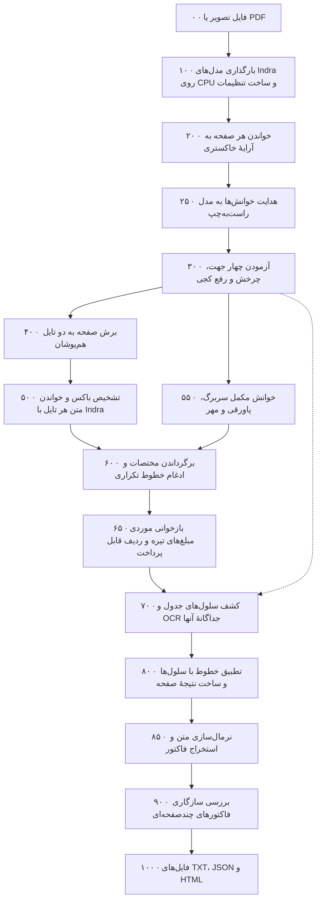
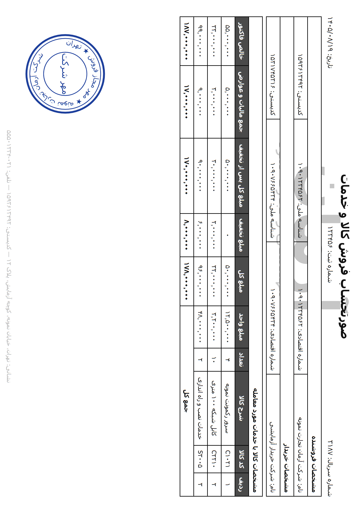

# مسیر کامل یک تصویر در پایپلاین Aftab OCR

این سند مسیر اجرای پیش‌فرض `python -m persian_ocr run` را از فایل ورودی تا خروجی‌های نهایی نشان می‌دهد. مبنا، کد فعلی `persian_ocr/` است. اعداد ۰ تا ۱۰۰ در جدول زیر **نقطه‌های مسیر** هستند، نه درصد زمان اجرا یا میزان پیشرفت واقعی.

## نمای یک‌صفحه‌ای



شاخهٔ جدول، تصویر صاف‌شده را دوباره پردازش می‌کند؛ ورودی آن متن تایل‌ها نیست. شاخه‌های سربرگ، پاورقی و مهر نیز فقط در حالت پیش‌فرضِ مهندسی‌شده اجرا می‌شوند و ممکن است هیچ خط تازه‌ای پیدا نکنند.

## تصویر در هر نقطه به چه چیزی تبدیل می‌شود؟

| نقطه | ورودی ← خروجی در حافظه | پردازش واقعی | کد |
|---|---|---|---|
| ۰ | مسیر `PNG/JPG/TIFF/BMP/WebP` یا `PDF` ← مسیر فایل | CLI فایل را پیدا می‌کند و `PipelineConfig` پیش‌فرض را می‌سازد. یک تصویر یک صفحه است؛ PDF می‌تواند چند صفحه باشد. | [`cli.py`](../persian_ocr/cli.py)، [`config.py`](../persian_ocr/config.py) |
| ۱۰ | پوشهٔ مدل ← `OcrEngine` | مدل‌های ONNX مربوط به Indra روی `CPUExecutionProvider` بار می‌شوند. موتور در حالت `ocr` ساخته می‌شود؛ برش‌های خیلی باریکِ ورودی recognizer تا حداقل ۳۲ پیکسل پَد می‌شوند. | [`engine.py`](../persian_ocr/engine.py) |
| ۲۰ | بایت‌های تصویر/PDF ← `gray: ndarray[H,W]` | تصویر با OpenCV مستقیم به خاکستری و بدون تغییر اندازهٔ صریح خوانده می‌شود. PDF با `pypdfium2` در وضوح پیش‌فرض ۳۰۰ DPI رندر و سپس خاکستری می‌شود. مقدار `dpi` اندازهٔ تصویر ورودی را تغییر نمی‌دهد. | [`pdfio.py`](../persian_ocr/pdfio.py) |
| ۲۵ | برش متن ← مسیر recognizer راست‌به‌چپ | پیش از جهت‌یابی، `force_rtl()` فعال می‌شود و در تمام اجرای مهندسی‌شده برش‌های خط را به خوانش RTL هدایت می‌کند. این مرحله پیکسل‌ها را عوض نمی‌کند؛ مسیر انتخاب مدل خوانش را عوض می‌کند. | [`engine.py`](../persian_ocr/engine.py)، [`pipeline.py`](../persian_ocr/pipeline.py) |
| ۳۰ | صفحهٔ خاکستری ← صفحهٔ چرخیده و صاف‌شده | چهار چرخش ۹۰ درجه‌ای روی نسخهٔ نصف‌اندازه امتیاز می‌گیرند: باکس‌های افقی و اطمینان خواندن چند خط بلند. بهترین جهت روی تصویر کامل اعمال می‌شود؛ سپس `ort.upright(..., turn=False)` کجی را اصلاح می‌کند. از اینجا مختصات باکس‌ها به تصویر صاف‌شده مربوط‌اند. | [`orientation.py`](../persian_ocr/orientation.py)، [`pipeline.py`](../persian_ocr/pipeline.py) |
| ۴۰ | تصویر صاف‌شده ← `top` و `bottom` | با `overlap_ratio=0.18`، تایل بالا از ۰ تا حدود ۵۹٪ ارتفاع و تایل پایین از حدود ۴۱٪ تا انتهای صفحه است. ۱۸٪ میانی در هر دو تایل دیده می‌شود. | [`tiling.py`](../persian_ocr/tiling.py)، [`pipeline.py`](../persian_ocr/pipeline.py) |
| ۵۰ | هر تایل خاکستری ← `list[Line]` | Indra روی هر تایل تشخیص خط و OCR را اجرا می‌کند. هر `Line` شامل `box=[x0,y0,x1,y1]`، `text` و `conf` است. این‌ها ابتدا در مختصات همان تایل‌اند. | [`engine.py`](../persian_ocr/engine.py)، [`pipeline.py`](../persian_ocr/pipeline.py) |
| ۵۵ | بخش‌های ویژهٔ تصویر ← خطوط مکمل | ۳۰٪ بالای صفحه با سفیدکردن پیکسل‌های روشن‌تر از ۱۳۵ و بلور ۳×۳ دوباره OCR می‌شود. در ۱۰٪ پایین صفحه، سطرهای عریض به پنجره‌های کوچک‌تر برای بازخوانی تقسیم می‌شوند. در صورت تشخیص مهر دایره‌ای، حلقه با `warpPolar` به نوار تبدیل و خوانده می‌شود. | [`watermark.py`](../persian_ocr/vision/watermark.py)، [`footer.py`](../persian_ocr/vision/footer.py)، [`stamps.py`](../persian_ocr/vision/stamps.py) |
| ۶۰ | خطوط تایل‌ها و خطوط مکمل ← خطوط صفحه | مختصات تایل پایین به مختصات صفحه برمی‌گردد. خطوط هم‌پوشان با IoU یا هم‌پوشانی افقی/عمودی ادغام می‌شوند و در برخورد، خوانش با اطمینان بالاتر می‌ماند. خروجی تقریباً از بالا به پایین و در هر ردیف از راست به چپ مرتب می‌شود. | [`tiling.py`](../persian_ocr/tiling.py) |
| ۶۵ | خطوط صفحه + تصویر صاف‌شده ← خطوط بازخوانی‌شده | دو اصلاح موردی اجرا می‌شود: بررسی شکل رقم‌ها در بعضی مبلغ‌های تیره، و بازخوانی جداگانهٔ برچسب/عدد/واحدِ ردیف «قابل پرداخت» وقتی شرط‌های هندسی و اطمینان برقرار باشند. این‌ها اصلاح عمومی همهٔ مبلغ‌ها نیستند. | [`pipeline.py`](../persian_ocr/pipeline.py) |
| ۷۰ | تصویر صاف‌شده ← `Table(rows=[[Cell,...]])` | OpenCV با آستانه‌گذاری و مورفولوژی خطوط افقی/عمودی جدول را پیدا می‌کند. ناحیه‌های محصور به سلول تبدیل و از بالا به پایین، در هر ردیف از راست به چپ مرتب می‌شوند. تشخیص خط و OCR داخل سلول‌ها دوباره انجام می‌شود؛ سرستون‌های تیره با دو نسخهٔ تصویری جداگانه خوانده می‌شوند. اگر کمتر از ۶ سلول پیدا شود، جدول خروجی ندارد. | [`cells.py`](../persian_ocr/tables/cells.py)، [`lines.py`](../persian_ocr/tables/lines.py)، [`dark.py`](../persian_ocr/tables/dark.py)، [`extract.py`](../persian_ocr/tables/extract.py) |
| ۸۰ | خطوط + سلول‌ها ← `PageOcr` و متن صفحه | خوانش خط و سلولِ متناظر سنجیده می‌شوند. خطی که متن سلول آن را پوشش دهد از `text_dedup` کنار می‌رود و متن سلول وارد می‌شود؛ برای برچسب «قابل پرداخت» گاهی سلول با متن خطِ پر اطمینان به‌روز می‌شود. تعارض‌های خاص به صف مرور می‌روند. سپس `raw_text` از خطوط غیرخالی ساخته می‌شود و خطوط داخل جدول که پوشش داده نشده‌اند می‌توانند در بخش تکمیلی `text_dedup` بیایند. | [`pipeline.py`](../persian_ocr/pipeline.py) |
| ۸۵ | متن خام + جدول ← متن اصلاح‌شده و فاکتور احتمالی | متن از نظر شکل حروف و ارقام نرمال می‌شود. قواعد کد ملی/شناسهٔ حقوقی، تاریخ، معادلهٔ سرمایه و دیکشنری دامنه روی متن اجرا می‌شوند. به‌طور مستقل، اگر سرستون اقلام جدول شناخته شود، ستون‌ها، ردیف‌ها، جمع‌ها و معادلات فاکتور به دادهٔ ساختاریافته تبدیل می‌شوند؛ وگرنه `invoice` تهی است. | [`postprocess.py`](../persian_ocr/text/postprocess.py)، [`parser.py`](../persian_ocr/invoice/parser.py) |
| ۹۰ | فاکتورهای صفحه‌ها ← نتیجهٔ چندصفحه‌ای | پس از ساخت همهٔ صفحه‌ها، رأی‌گیری بعضی فیلدهای سربرگ، کنترل جمع‌های بین‌صفحه‌ای و اصلاح مقیاسِ بعضی ردیف‌ها روی `invoice`ها اجرا می‌شود. این مرحله متن خام یا `tables_markdown` را دوباره تولید نمی‌کند. | [`document.py`](../persian_ocr/invoice/document.py)، [`pipeline.py`](../persian_ocr/pipeline.py) |
| ۱۰۰ | شیء نتیجه ← فایل خروجی | اجرای `run` با نام پایهٔ فایل ورودی، فایل‌های `txt`، `json` و `html` را در پوشهٔ `--out` می‌نویسد. `txt` از `text_dedup` ساخته می‌شود؛ `html` پیش‌نمایش فایل اصلی را کنار متن و موارد مرور نشان می‌دهد. | [`files.py`](../persian_ocr/report/files.py)، [`html.py`](../persian_ocr/report/html.py) |

## شکل داده‌ها در طول مسیر

```text
فایل تصویر/PDF
  → یک یا چند صفحهٔ خاکستری: ndarray[ارتفاع, عرض]
  → تصویر صاف‌شده: ndarray[ارتفاع جدید, عرض جدید]
  → دو تایل خاکستری با هم‌پوشانی
  → خطوط OCR: Line(box, text, conf)
  → خطوط ادغام‌شده در مختصات صفحه
  → سلول‌ها: Cell(box, text, conf)
  → جدول: Table(box, rows)
  → نتیجهٔ صفحه: raw_text + text + text_dedup + invoice + review_queue
  → نتیجهٔ سند: file + time_sec + pages[]
  → <نام>.txt + <نام>.json + <نام>.html
```

سه متن اصلی یکسان نیستند:

- `raw_text`: خطوط OCR بعد از ادغام و بازخوانی‌های موردی، پیش از قواعد متنی.
- `text`: همان متن پس از نرمال‌سازی و اصلاح‌های متنی.
- `text_dedup`: متن ترکیبیِ خطوط و ردیف‌های جدول؛ همین مقدار به فایل `txt` می‌رود.

JSON هر صفحه علاوه بر این سه متن، `corrections`، `review_queue`، `low_confidence_lines`، `tables_markdown` و `invoice` را دارد. `low_confidence_lines` فقط خطوط غیرخالی با اطمینان کمتر از `0.75` را با باکس ثبت می‌کند؛ این آستانه به‌تنهایی فرمان بازخوانی همهٔ خطوط ضعیف نیست.

## دیدن خروجی روی یک تصویر

تصویر نمونهٔ زیر همراه پروژه است و مسیر فرمان بعدی از آن شروع می‌شود:



از ریشهٔ پروژه در PowerShell اجرا کنید:

```powershell
.\.venv\Scripts\python.exe -m persian_ocr run "samples\invoice-sample.png" --out "output\pipeline-example"
```

`samples/invoice-sample.png` تصویر نمونهٔ داخل پروژه است. می‌توانید مسیر آن را با تصویر خود، مثلاً `file\2bd26e3e-img__4293952.png`، عوض کنید. پس از اجرا این سه فایل ساخته می‌شوند:

| فایل | چیزی که می‌بینید |
|---|---|
| `output/pipeline-example/invoice-sample.txt` | متن `text_dedup` هر صفحه |
| `output/pipeline-example/invoice-sample.json` | متن‌های مرحلهٔ آخر، اصلاح‌ها، موارد نیازمند مرور، جدول‌های متنی و فیلد `invoice` که می‌تواند تهی باشد |
| `output/pipeline-example/invoice-sample.html` | پیش‌نمایش تصویر ورودی کنار متن، اصلاح‌ها، خطوط کم‌اطمینان و فاکتور در صورت شناسایی |

در اجرای همین فرمان روی نسخهٔ فعلی پروژه، تصویر نمونه این مسیر را طی کرد. مقدارهای میانی از `on_page` خوانده شده‌اند و در فایل‌های عادی خروجی ذخیره نمی‌شوند:

| نقطه | مقدار مشاهده‌شده برای همین تصویر |
|---|---|
| ۲۰ | صفحهٔ خاکستری با ابعاد `2500 × 1760` پیکسل، به ترتیب ارتفاع × عرض |
| ۳۰ | تصویر پس از جهت‌یابی و رفع کجی با ابعاد `1760 × 2500` پیکسل |
| ۴۰ | تایل بالا: ردیف‌های `0..1038`؛ تایل پایین: `721..1760`؛ ناحیهٔ مشترک: `317` ردیف |
| ۵۵ | سربرگِ پاس مکمل: `0..528` ردیف از تصویر صاف‌شده |
| ۶۰ | `60` خط در `PageOcr.lines` پس از ادغام |
| ۷۰ | `1` جدول با `56` سلول در `PageOcr.tables` |
| ۸۰ تا ۱۰۰ | یک صفحه، `8` خط کم‌اطمینان، `6` مورد نیازمند مرور، `invoice=null` و سه فایل خروجی |

این عددها نتیجهٔ مشاهده‌شدهٔ همین تصویرند و برای تصاویر دیگر ثابت نیستند. وجود یک `Table` نیز به معنای موفقیت در تشخیص فاکتور نیست؛ برای این نمونه سرستون‌های لازم برای ساخت `invoice` شناسایی نشدند.

برای آزمایش بدون دیکشنری سازمان از `--no-lexicon`، بدون جدول از `--no-tables` و بدون HTML از `--no-html` استفاده کنید. دستور `debug` مسیر جداگانه‌ای برای جدول و معادلات **یک صفحه** است و جای اجرای کامل `run` را نمی‌گیرد. API نیز همان `process_document` را فراخوانی می‌کند، اما پاسخ HTTP می‌دهد؛ ذخیرهٔ سه فایل بالا مخصوص CLI `run` است.

## تنظیمات پیش‌فرض که این مسیر را تعیین می‌کنند

| گزینهٔ `PipelineConfig` | مقدار | اثر |
|---|---:|---|
| `dpi` | `300` | فقط وضوح رندر PDF |
| `tiling` | `True` | دو تایل به‌جای OCR یک‌بارهٔ کل صفحه |
| `overlap_ratio` | `0.18` | ناحیهٔ مشترک دو تایل |
| `engineered` | `True` | جهت‌یابی، اجبار RTL و خوانش‌های مکمل/موردی |
| `tables` | `True` | استخراج سلول و تلاش برای ساخت فاکتور؛ فقط با `engineered=True` اجرا می‌شود |
| `header_fraction` | `0.30` | ارتفاع سربرگ برای پاس حذف واترمارک |
| `low_conf` | `0.75` | آستانهٔ ثبت خطوط کم‌اطمینان و یکی از شرط‌های متن تکمیلی |
| `use_lexicon` | `True` | کاربرد دیکشنری دامنه در اصلاح متن |
| `max_pages` | `0` | همهٔ صفحه‌های PDF؛ برای تصویر همیشه یک صفحه |

`PipelineConfig.baseline(tiling=False)` مسیر ساده‌تری برای مقایسه است: جهت‌یابی مهندسی‌شده، خوانش‌های مکمل، جدول و دیکشنری را خاموش می‌کند. اجرای خام `indra-ocr` که در مقایسهٔ قبلی استفاده شد نیز خروجی همین مسیر پیش‌فرض پروژه نیست.

## کدام تصاویر میانی واقعاً ذخیره می‌شوند؟

در اجرای فعلی `run`، تصویر خاکستری، تصویر چرخیده/صاف‌شده، تایل‌ها، سربرگِ پاک‌سازی‌شده و برش‌های سلول **فایل جداگانه ندارند**. همهٔ باکس‌های `Line` نیز به JSON نهایی منتقل نمی‌شوند؛ فقط باکس خطوط کم‌اطمینان در `low_confidence_lines` ثبت می‌شود. HTML تصویر اصلی را با متن نشان می‌دهد و تصویر هر مرحله یا همهٔ باکس‌ها را روی آن رسم نمی‌کند. در کد، `on_page` می‌تواند پس از OCR به تصویر صاف‌شده و `PageOcr` دسترسی دهد، ولی CLI عادی آن را به فایل خروجی وصل نکرده است.

برای دیدن **تصویر واقعی هر مرحله**، ابزار مستقل [`pipeline_visual_report.py`](../tools/pipeline_visual_report.py) را اجرا کنید:

```powershell
.\.venv\Scripts\python.exe tools\pipeline_visual_report.py "file\2bd26e3e-img__4293952.png" --out "file\2bd26e3e-img__4293952_pipeline_trace.html"
```

گزارش یک فایل HTML مستقل با تصاویر جاسازی‌شده است. دکمه‌های «مرحلهٔ قبل/بعد»، بزرگ‌نمایی با کلیک و دانلود تصویر هر مرحله دارد. در ۲۰ مرحله، تصویر ورودی و خاکستری، چهار جهت آزمایشی، چرخش و رفع کجی، هر دو تایل و باکس‌های OCR آنها، پاس سربرگ، پاورقی، مهر در صورت وجود، ادغام و بازخوانی خطوط، تصویر دودویی و ماسک خطوط جدول، سلول‌های تیره، باکس‌های سلول و متن نهایی را می‌بینید. ابزار برای نمایش باکس‌های هر تایل یک پاس OCR اضافه اجرا می‌کند و در خود گزارش اعلام می‌کند که نتیجهٔ بازپخش با اجرای اصلی یکسان بوده است یا نه. با `--max-side 6000` می‌توانید وضوح تصاویر جاسازی‌شده را بیشتر کنید.

این محدودیت هنگام بررسی مبلغ‌ها مهم است: شاخه‌های بازخوانی، ادغام خط/سلول و استخراج جمع فاکتور ممکن است خوانش‌ها را تغییر دهند. کد فعلی در بعضی اختلاف‌های عددی همهٔ گزینه‌ها را در خروجی نهایی نگه نمی‌دارد؛ برای مبالغ حساس باید تصویر اصلی، `raw_text`، `text_dedup`، `invoice` و `review_queue` با هم بررسی شوند.
